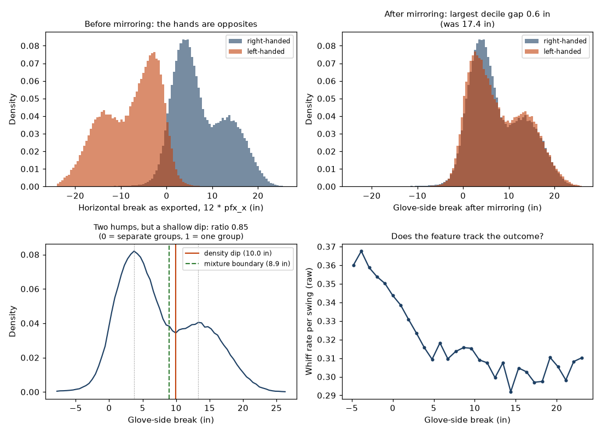
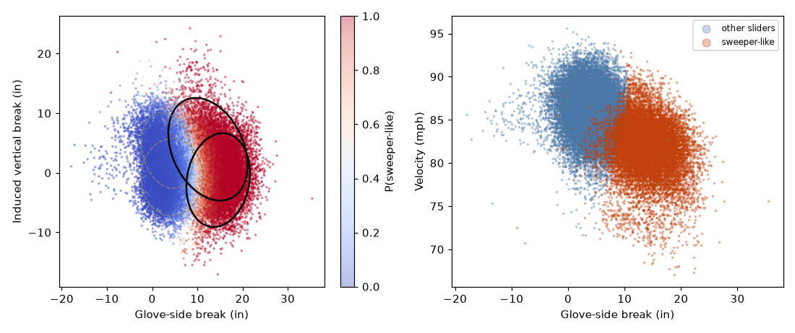
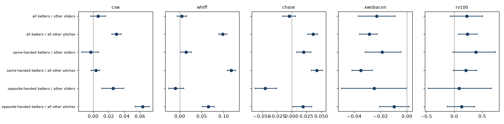
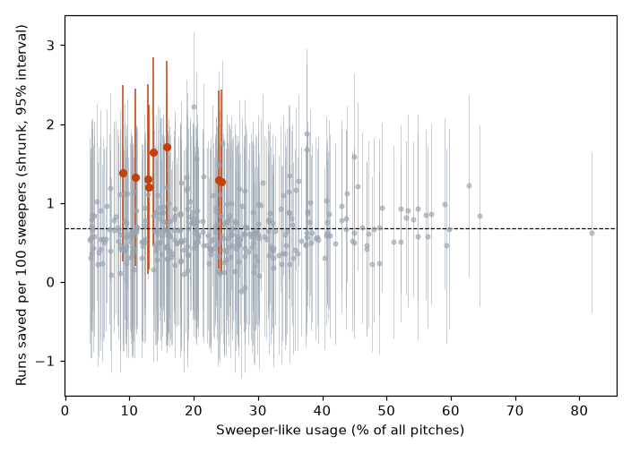

# Sweeper Finder

Which sliders behave like sweepers, how do they do compared with the rest of the pitcher's
arsenal, and which pitchers throw a good one less often than their profile suggests?

It uses 322,391 slider-class pitches (Statcast `SL`, `ST` and `SV`) from the 2023 and 2024 regular
seasons. Pitches are grouped by what they do (glove-side break, induced vertical break and
velocity) with a Gaussian mixture fit without any labels. Statcast's `ST` label is used only
afterwards, as an outside check.

## Before the mixture: is there anything to split?

A mixture model will return groups whether or not the data contains any. Three checks run before it
is fit, and their output is in `reports/tables/eda_*.csv` and the panel below.



- **Did mirroring work?** Left-handers' glove-side break is flipped so both hands share a sign. The
  existing check compared means; this compares the full shape, decile by decile. The largest gap
  between right- and left-handers falls from **17.4 inches before mirroring to 0.6 inches after**.
  The two hands are now the same distribution, which is what pooling them assumes.
- **How finely is break recorded?** Statcast exports `pfx_x` rounded to 0.01 ft, so break lives on a
  **0.12-inch lattice** (382 distinct values). Any histogram bin that is not a whole multiple of
  0.12 inches alternately catches two or three lattice points and produces a regular comb of
  spikes. Every bin width here is a multiple of the lattice step. This is not cosmetic: unaligned
  bins made the dip below look about a fifth deeper than it is.
- **Is there a dip to cut at?** Pooled break is bimodal, with humps at **3.7 and 13.3 inches** and a
  low point at **10.0 inches**. But the dip is shallow: density at the low point is **85% of the
  smaller hump**, and the second hump stands only about 7% of the peak height above the dip. Under
  heavy smoothing it disappears entirely (`eda_break_valley_sensitivity.csv`). The separation is
  real and it is weak.

The last point matters for how the headline should be read. The mixture's own boundary, found in
three dimensions, crosses 50% at **8.9 inches of break**; the dip in the one-dimensional
distribution sits at **10.0 inches**. Two unrelated methods landing within about an inch is good
evidence the boundary is a property of the data rather than a round number someone picked. It is
not evidence that sweepers and sliders are cleanly separate pitches — the two groups overlap
heavily, which is why 144 pitcher-seasons land in the review queue and why the label should be
treated as a probability rather than a fact.

One more thing the panel shows: whiffs per swing **fall** as break increases, from 0.37 at -4
inches to 0.30 past 15 inches. Sweeper-like pitches are not missing more bats because they sweep.
That agrees with the within-pitcher result below, where the whiff advantage vanishes once the
comparison is against the pitcher's other sliders.

## What it found



- **Shape groups.** Four components. Two are high-break: 12 to 15 inches of glove-side break at
  about 82 mph, one with vertical break near -1 inch (22% of pitches) and one near +4 inches (18%). Two are
  ordinary sliders: 3 to 4 inches of break at 85 to 87 mph. 38% of slider-class pitches are
  sweeper-like.
- **Stability.** Refitting on bootstrap samples reproduces the labels with an adjusted Rand index of
  0.98 (worst of ten: 0.97). A model fit on 2023 alone labels 2024 pitches with an index of 0.95
  against the pooled fit. Fitting right- and left-handers separately gives 0.96.
- **Against Statcast's label.** 90% of `ST` pitches are sweeper-like, but only 72% of sweeper-like
  pitches are `ST` (adjusted Rand index 0.52). The mixture's group is broader. The biggest
  disagreements are submarine-style sliders with huge vertical break and `ST`-labelled pitches with
  moderate break; they are in `reports/tables/st_label_disagreements.csv`.
- **Outcomes within the same pitcher.** Against *all* of a pitcher's other pitches, his
  sweeper-like pitch gets 9.8 more whiffs per 100 swings (95% interval 8.8 to 10.7), 3.0 more CSW per
  100 pitches, and 3.6 more chases per 100 out-of-zone pitches. Against his *other sliders*
  the whiff and CSW differences disappear (+0.5 and +0.6 points, intervals include zero). What
  is left is less damage on contact: xwOBAcon lower by 0.023 (interval -0.037 to -0.009).
  Most of the sweeper advantage in raw numbers is a breaking-ball advantage, not a sweeper-shape
  advantage.



- **Does throwing it more cost you?** Across 128 pitchers with at least 75 sweeper-like pitches in both
  seasons, a 10-point increase in usage went with a change of -0.09 runs per 100 sweepers (interval
  -0.45 to +0.29). The data cannot tell a modest penalty from none.
- **Under-use.** 8 of the 377 pitcher-seasons with at least 100 sweeper-like pitches clear all three
  tests (better than league with 80% probability, usage below profile by more than noise, still above
  league under the pessimistic usage penalty). Flagged: Buck Farmer 2023, Randy Rodriguez 2024, Bryan
  Woo 2024, Graham Ashcraft 2024, Seranthony Dominguez 2024, Cionel Perez 2023, Sam Moll 2024,
  Grayson Rodriguez 2023. Treat these as questions to put to a pitching coach, not conclusions:
  the table with intervals is `reports/tables/sweeper_pitcher_seasons.csv`.



## What a person should look at

- `reports/tables/review_queue.csv`: 144 pitcher-seasons whose label is unreliable, either because many
  of their pitches sit near the boundary or because Statcast's label disagrees with the mixture.
- `reports/tables/changepoints.csv`: 50 pitchers whose sweeper-like rate shifts abruptly. A shift from
  0.01 to 0.82 is probably a new pitch; a shift from 0.86 to 0.00 might be a dropped pitch or
  a relabel. The tracking data cannot tell which.
- `reports/tables/st_label_switches.csv`: 33 pitchers whose `ST` share changes by half or more between
  the start and the end of their data.

## Limits

- The mixture finds groups of shapes; it does not know what a sweeper is. The sweeper-like set includes
  riding and dropping variants and some submarine sliders.
- Comparisons within a pitcher remove pitcher quality but not when and where he chooses to throw the
  pitch.
- Under-use is judged against peers with a similar profile, not against what would be optimal.
  Usage changes between seasons are not random, so the usage-quality slope is not causal.
- Run value per 100 sweepers is noisy at a few hundred pitches. Most pitchers cannot be separated
  from the league average with confidence.

More detail: [docs/definitions.md](docs/definitions.md), [docs/requirements.md](docs/requirements.md),
[docs/data_quality.md](docs/data_quality.md), [docs/design_decisions.md](docs/design_decisions.md).

## Run it

```bash
python -m venv .venv && source .venv/bin/activate
pip install -e '.[dev]'
pytest                      # 39 tests, including planted-shape and planted-dip recovery
sweeper-finder demo         # mixture on the packaged 2,500-pitch sample, offline
```

To reproduce the results above (downloads about 400 daily files; the run takes a couple of minutes):

```bash
sweeper-finder fetch --cache data/cache
sweeper-finder run   --cache data/cache --out reports
```

Tables go to `reports/tables`, figures to `reports/figures`. `notebooks/sweeper_walkthrough.ipynb`
walks through the shape features, the fit and the first outcome comparison.

Where things are: `shapes.py` builds the slider pool and mirrors left-handers, `eda.py` runs the
checks in the section above, `mixture.py` chooses the number of components and fits them,
`outcomes.py` and `usage.py` do the within-pitcher comparisons and the under-use tests, and
`integrity.py` holds the assertions that stop the run if the data is not what the code assumes.

## Data

Pitch data are from Baseball Savant (Statcast). Raw data are not committed. The repository includes a
2,500-pitch sample and the result tables.

MIT license.
